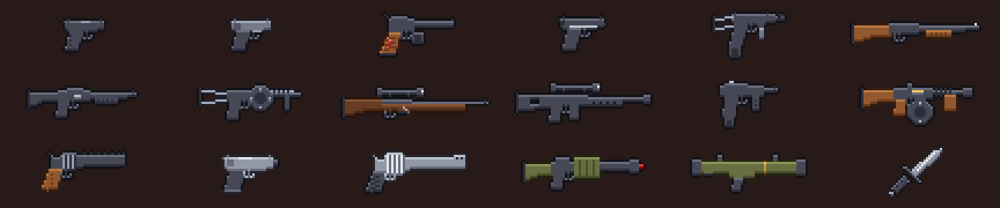

# RE4 Weapons (Terraria / tModLoader)

Mod de **tModLoader 1.4.4** que agrega **las 18 armas del Resident Evil 4 (2005)**. Mismo sistema que WW2 Guns: sprites, código y traducciones generados con Python.

*A tModLoader mod that adds the 18 weapons of Resident Evil 4 (2005). English and Spanish translations included. Fan-made, not affiliated with Capcom.*



## Cómo se consiguen

1. **Crafteo** (todas): mismos niveles que WW2 Guns (1 a 8) más un **nivel 9** post-Plantera: 15 Lingote de clorofita + 6 Ectoplasma en Yunque de mithril/oricalco. El cuchillo sale con 6 lingotes de hierro/plomo.
2. **Tienda del Traficante de armas** (hace de Mercader): se van desbloqueando a medida que matás jefes.
3. **Drops raros**: Killer7 (Tactical Skeleton), Rocket Launcher (Skeleton Commando), Striker (Pirate Deadeye).

Las armas usan **balas**; el Mine Thrower y el Rocket Launcher usan **cohetes** (disparan minas de proximidad y cohetes como los lanzadores del juego base).

## Armas

| Categoría | Arma | Tipo | Daño | Tiempo de uso | Nivel | Otras formas de obtenerla |
|---|---|---|---|---|---|---|
| Pistolas | Handgun | Pistola | 11 | 15 | 1 | Tienda del Traficante de armas |
| Pistolas | Punisher | Pistola | 13 | 16 | 2 | Tienda del Traficante de armas (post Ojo de Cthulhu) |
| Pistolas | Red9 | Pistola | 24 | 20 | 3 | Tienda del Traficante de armas (post jefe del mal) |
| Pistolas | Blacktail | Pistola | 20 | 11 | 4 | Tienda del Traficante de armas (post Skeletron) |
| Pistolas | Matilda | Pistola automática | 16 | 4 | 5 | Tienda del Traficante de armas (Hardmode) |
| Escopetas | Shotgun | Escopeta | 10 x5 | 45 | 3 | Tienda del Traficante de armas (post Ojo de Cthulhu) |
| Escopetas | Riot Gun | Escopeta | 18 x6 | 40 | 5 | Tienda del Traficante de armas (Hardmode) |
| Escopetas | Striker | Escopeta | 24 x6 | 22 | 7 | Drop 1/20 de PirateDeadeye |
| Rifles | Rifle | Rifle de cerrojo | 40 | 42 | 3 | Tienda del Traficante de armas (post Skeletron) |
| Rifles | Rifle (semi-auto) | Rifle semiautomático | 62 | 22 | 6 | Tienda del Traficante de armas (post 1 jefe mecánico) |
| Ametralladoras | TMP | Subfusil | 9 | 5 | 4 | Tienda del Traficante de armas (post Skeletron) |
| Ametralladoras | Chicago Typewriter | Subfusil | 40 | 5 | 9 | - |
| Mágnums | Broken Butterfly | Mágnum | 85 | 32 | 6 | Tienda del Traficante de armas (post 1 jefe mecánico) |
| Mágnums | Killer7 | Mágnum | 80 | 22 | 7 | Drop 1/12 de TacticalSkeleton |
| Mágnums | Handcannon | Mágnum | 240 | 40 | 9 | - |
| Especiales | Mine Thrower | Lanzaminas | 45 | 35 | 6 | Tienda del Traficante de armas (post 1 jefe mecánico) |
| Especiales | Rocket Launcher | Lanzacohetes | 120 | 50 | 8 | Tienda del Traficante de armas (post los 3 mecánicos), Drop 1/10 de SkeletonCommando |
| Especiales | Knife | Cuchillo | 10 | 14 | 1 | - |

Punisher y los mágnums atraviesan enemigos, la Matilda dispara ráfagas de 3, los rifles tienen mira telescópica y la Chicago Typewriter tiene munición infinita (igual que en el juego, necesita tener balas en el inventario).

## Editar

```
python tools/gen_mod.py   # sprites .png + código .cs + traducciones
python tools/art.py       # icon.png, icon_workshop.png e imágenes de workshop/
```

## Instalar para probar

1. Cloná este repo dentro de `Documentos/My Games/Terraria/tModLoader/ModSources/` **con el nombre de carpeta `RE4Weapons`**:
   ```
   git clone https://github.com/jonatanmonti/Terraria-Mod-RE4-Guns.git RE4Weapons
   ```
2. Abrí tModLoader → **Workshop → Develop Mods** → **Build + Reload** en RE4 Weapons.

## Dibujos

Dibujos en `tools/guns.py`, estadísticas, recetas, tienda y drops en `tools/stats.py`.
